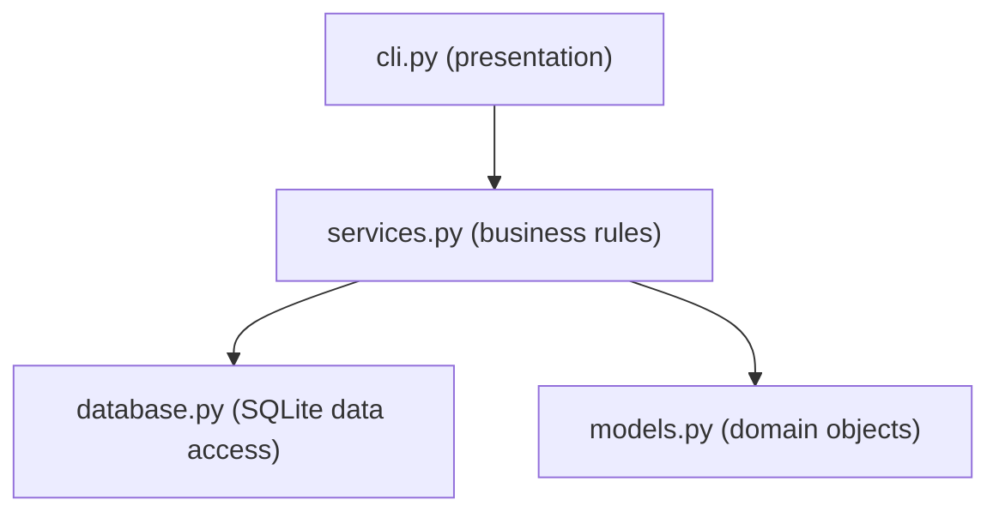
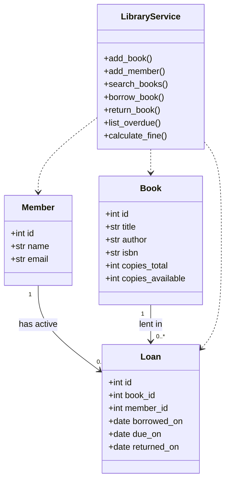
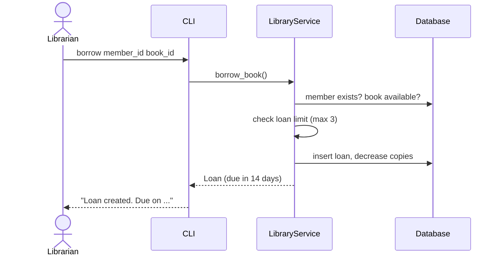

# Design: Library Management System

## Architecture
Three layers, each depending only on the layer below it.

## Class diagram

## Sequence: borrowing a book

## Design decisions
- **Layering** keeps business rules independent from the CLI, so a web UI can be added later.
- **Custom exceptions** (`NotFoundError`, `DuplicateError`, `RuleViolationError`) make errors explicit and testable.
- **Date injection** (`today` parameter) makes time-dependent rules such as fines easy to test.
- **SQLite constraints** are a second safety net behind the Python checks.
